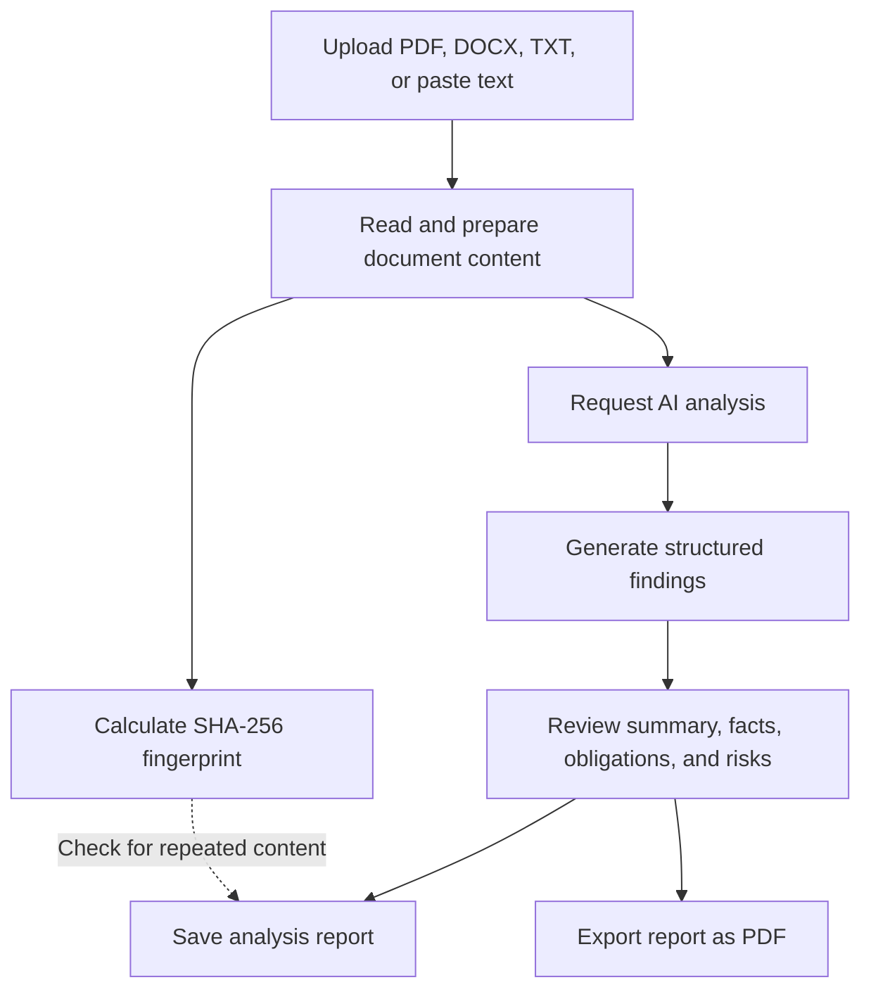
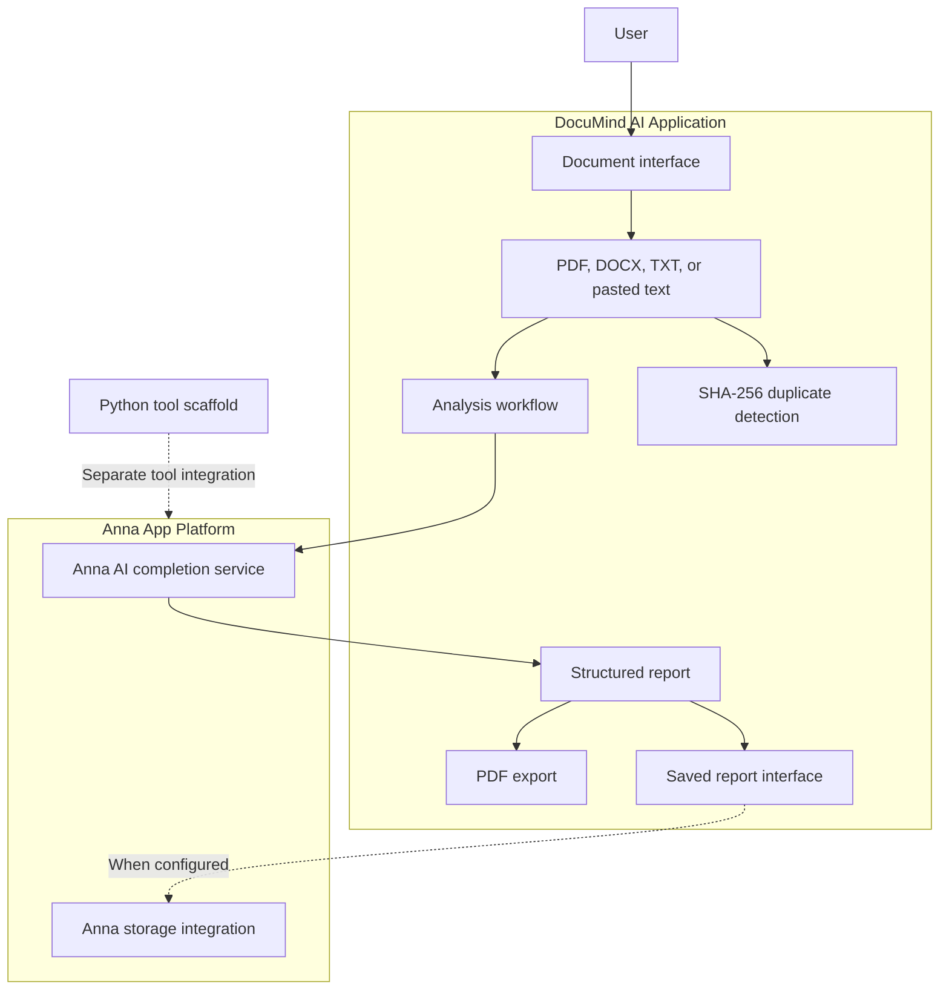
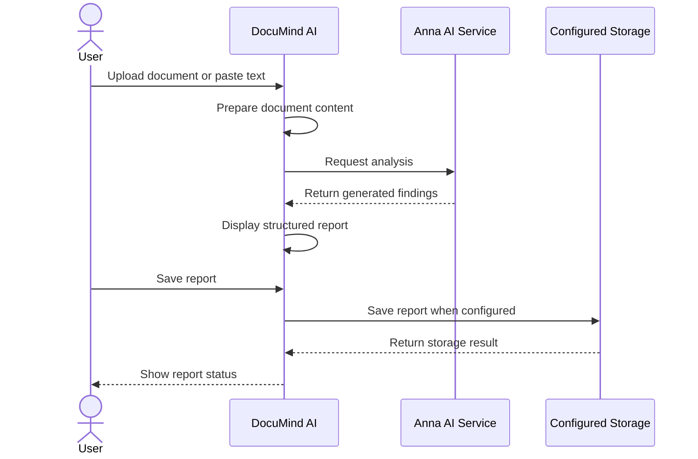

<div align="center">


<br />

# DocuMind AI

### Make every document clearer.

**AI-powered document intelligence to help you understand complex documents, identify important obligations, review potential risks, and create clear reports.**

<br />


<br />

**Understand · Review · Save · Export**

</div>

---

## Table of Contents

- [Overview](#overview)
- [The Problem and Our Solution](#the-problem-and-our-solution)
- [Key Features](#key-features)
- [How DocuMind AI Works](#how-documind-ai-works)
- [System Architecture](#system-architecture)
- [Document Analysis Workflow](#document-analysis-workflow)
- [Reports and Document History](#reports-and-document-history)
- [Privacy and Data Handling](#privacy-and-data-handling)
- [Technology Stack](#technology-stack)
- [Project Structure](#project-structure)
- [Getting Started](#getting-started)
- [Using the App](#using-the-app)
- [Limitations](#limitations)
- [Roadmap](#roadmap)
- [Responsible AI and Disclaimer](#responsible-ai-and-disclaimer)
- [Contributing](#contributing)
- [License](#license)
- [Author](#author)

---

## Overview

Documents often contain important information that is difficult to identify quickly. Contracts, policies, business documents, reports, and other lengthy files can require significant time and effort to understand.

**DocuMind AI** is a document intelligence application designed to make this process simpler. It helps users transform document content into structured, understandable reports containing summaries, key facts, important clauses, obligations, potential risks, action items, and questions for further review.

The application provides a document analysis workflow through the Anna App platform, with options to save results, revisit previous analyses, export reports, and identify repeated document content.

### The core workflow

1. **Understand** — Upload a document or paste text to request an AI-generated analysis.
2. **Review** — Examine the summary, important facts, obligations, potential risks, action items, and suggested questions.
3. **Save** — Keep useful reports available for later review.
4. **Export** — Generate a PDF report for reference or sharing.

### Designed for clarity

DocuMind AI focuses on presenting useful information in a structured format rather than requiring users to manually search through every paragraph.

The goal is to make document review more accessible, efficient, and understandable.

---

## The Problem and Our Solution

### The problem

- Long documents take time to read and understand.
- Important clauses and obligations can be overlooked.
- Potential risks may be difficult to recognize.
- Users may struggle to decide which questions need further investigation.
- Repeated analysis can create unnecessary duplicate reports.
- Useful findings can be difficult to organize and revisit.

### Our solution

DocuMind AI combines AI-assisted analysis with saved reports, PDF export, and duplicate-content detection.

| User need | DocuMind AI approach |
|---|---|
| Understand a lengthy document | Generate a plain-language summary |
| Find important information | Identify key facts and important clauses |
| Review responsibilities | Highlight key obligations |
| Identify potential concerns | Present possible risks for further examination |
| Plan next steps | Generate action items |
| Prepare follow-up questions | Suggest questions for further review |
| Keep useful findings | Save and reopen analysis reports |
| Share a readable report | Export analysis results as PDF |
| Avoid repeated reports | Use SHA-256 fingerprints to detect previously analyzed text |

---

## Key Features

### 1. Multi-format document input

DocuMind AI supports:

- **PDF uploads**
- **DOCX uploads**
- **TXT uploads**
- **Pasted text**

The configured document size limit is 15 MB.

The quality of analysis depends on the readability and extraction of the source content. Scanned documents may require OCR if their text cannot be extracted directly.

### 2. AI-powered document analysis

The analysis workflow is designed to organize document information into useful sections:

- **Summary:** A plain-language overview of the document.
- **Key facts:** Important details and statements.
- **Important clauses:** Clauses that may deserve closer attention.
- **Key obligations:** Responsibilities and commitments identified in the text.
- **Potential risks:** Possible concerns that warrant further review.
- **Action items:** Suggested follow-up steps.
- **Questions for a lawyer:** Questions to consider when professional legal review is appropriate.

AI-generated results should always be checked against the original document.

### 3. Saved reports

Users can save analysis reports and return to them later.

The workspace supports reviewing previous results and deleting reports when they are no longer needed.

The availability and persistence of saved reports depend on the application's configured storage and platform environment.

### 4. PDF report export

DocuMind AI can export analysis results as a readable PDF report.

This makes it easier to retain a copy of findings for reference, organize document reviews, or share information when appropriate.

Exported reports should be reviewed before being relied upon for important decisions.

### 5. SHA-256 duplicate detection

DocuMind AI uses SHA-256 fingerprinting to help identify repeated document text.

The fingerprint can be used to recognize previously analyzed content and avoid creating duplicate saved reports for the same analyzed text.

**Important:** A matching fingerprint indicates matching hashed content. It does not establish who authored the document, whether it is authentic, or whether its contents are legally valid.

### 6. Document size handling

The current configured document size limit is 15 MB.

Successful processing also depends on the file format, the readability of the document, and the availability of the required platform services.

---

## How DocuMind AI Works

The application follows a simple document-to-report workflow.



The diagram represents the intended workflow. Successful analysis depends on the AI service responding correctly, while saving and exporting depend on their respective application functions.

---

## System Architecture

DocuMind AI is packaged as an Anna App. Its current project includes an application bundle and an associated Python tool scaffold.



### Component responsibilities

| Component | Responsibility |
|---|---|
| Application interface | Document input, analysis controls, and report display |
| Document processing | Prepare supported document content for analysis |
| AI completion integration | Request AI-generated analysis through the platform |
| Report generation | Organize analysis into readable sections |
| PDF export | Produce a downloadable report |
| Saved report interface | Review and manage previously saved results |
| SHA-256 fingerprinting | Identify repeated analyzed content |
| Anna storage integration | Provide storage operations where configured |
| Python tool scaffold | Provide a separate tool integration point |

The Python tool scaffold is not the same as the AI analysis engine. The frontend's analysis workflow uses the Anna AI completion integration. The scaffold should not be described as performing document analysis unless that functionality is actually implemented and connected.

---

## Document Analysis Workflow

The typical workflow is:

1. The user provides a supported document or pastes text.
2. The application prepares the document content.
3. The analysis workflow requests AI completion.
4. The returned information is organized into a structured report.
5. The user reviews the findings.
6. The report can be saved or exported as a PDF.
7. The application can use the document fingerprint to recognize repeated content.



A completed upload does not automatically prove that AI analysis succeeded. Likewise, displaying a report does not by itself prove that the report was persistently saved. These operations should be evaluated separately.

---

## Reports and Document History

### Report contents

Depending on the analysis result, a report may include:

- Document summary
- Key facts
- Important clauses
- Obligations
- Potential risks
- Action items
- Questions for further review

### Report management

The application supports a workflow for saving, viewing, and deleting reports, as well as exporting analysis results to PDF.

### Duplicate detection

SHA-256 fingerprinting helps recognize repeated analyzed text.

The fingerprint is a content identifier, not a substitute for document authentication or a complete document-management system.

### Persistence considerations

Saved-report availability depends on the configured storage implementation. Users should verify that reports remain available after restarting the application before relying on long-term retention.

---

## Privacy and Data Handling

Privacy is important when analyzing contracts, business records, and other potentially sensitive documents.

DocuMind AI uses the Anna App platform for its AI completion workflow. **It should not be described as an offline-only or local-AI application.**

### Data-handling considerations

- **Document content:** Text extracted from documents may be submitted to the configured AI service.
- **Saved reports:** Report content may be stored through the configured storage implementation.
- **Duplicate detection:** SHA-256 fingerprints can identify repeated content but do not encrypt the original document.
- **PDF exports:** Exported reports may contain sensitive information from the source document.
- **Third-party processing:** Review the relevant platform privacy policies before submitting confidential material.

### Recommended precautions

- Use non-confidential sample documents when testing.
- Avoid uploading sensitive personal, financial, or legal documents unless you understand the applicable data-handling arrangements.
- Store exported reports securely.
- Do not publish private documents, access tokens, or credentials in the repository.
- Delete saved reports when appropriate, while remembering that deletion from the interface does not necessarily remove every backup or external copy.

---

## Technology Stack

| Layer | Technology |
|---|---|
| Application platform | Anna App |
| Application interface | JavaScript and bundled web assets |
| AI integration | Anna AI completion API |
| Document inputs | PDF, DOCX, TXT, and pasted text |
| Report output | PDF export |
| Content fingerprinting | SHA-256 |
| Storage integration | Anna storage API where configured |
| Tool scaffold | Python |
| Validation and publishing | Anna App developer CLI |
| Version control | Git and GitHub |

The exact implementation and available functionality depend on the current application bundle and platform configuration.

---

## Project Structure

The primary files in the current repository include:

```text
DocuMind-AI/
+-- app.json
+-- manifest.json
+-- README.md
+-- bundle/
|   +-- app.js
|   +-- index.html
+-- assets/
+-- executas/
    +-- documind-ai/
        +-- executa.json
        +-- documind_ai_plugin.py
        +-- pyproject.toml
```

The logo path above is the intended location; the image must be added to that folder before the logo appears in the README.

### Important files

- `app.json` — Application metadata.
- `manifest.json` — Application manifest and platform configuration.
- `bundle/app.js` — Main application logic.
- `bundle/index.html` — Application HTML entry point.
- `executas/documind-ai/documind_ai_plugin.py` — Python tool scaffold.
- `README.md` — Project documentation.

Avoid committing local credentials, authentication files, unnecessary backups, or private document samples.

---

## Getting Started

### Prerequisites

- Windows, macOS, or Linux development environment.
- Node.js and npm compatible with the installed Anna App CLI.
- Anna App CLI.
- An Anna Partners account and valid authentication for platform publishing.
- Access to the AI functionality required by the application.

### 1. Clone the repository

```bash
git clone https://github.com/Hajrajadoon/DocuMind-AI.git
cd DocuMind-AI
```

### 2. Validate the application

Install and configure the Anna App CLI according to its official documentation, then run:

```powershell
anna-app validate
```

The validator checks the application's configuration against the supported app schema.

### 3. Run the development app

From the project directory:

```powershell
anna-app dev --no-watch --port 5181
```

Open the local address shown by the CLI. The expected local URL for this configuration is:

`http://localhost:5181/`

AI functionality may depend on the Anna platform session and available services.

### 4. Test the workflow

Use a short, non-confidential sample document to test:

1. Document input.
2. AI analysis.
3. Report display.
4. PDF export.
5. Saved report behavior.
6. Duplicate detection.

Test each feature independently and verify the results before relying on them.

---

## Using the App

### Analyze a document

1. Open DocuMind AI.
2. Upload a PDF, DOCX, or TXT file, or paste text.
3. Start the analysis.
4. Review the generated summary and findings.
5. Verify important statements against the original document.

### Save a report

1. Complete an analysis.
2. Use the report-saving action.
3. Check the saved-report interface.
4. Reopen the report to confirm it can be retrieved.

### Export a PDF

1. Open the analysis report.
2. Use the PDF export action.
3. Open the generated file.
4. Check that the report content is readable and complete.

### Check for duplicate content

Analyze the same text again and confirm that the duplicate-detection workflow behaves as expected.

Minor changes to document content can produce a different SHA-256 fingerprint.

---

## Limitations

- **AI reliability:** AI-generated findings can be incomplete or incorrect.
- **Document extraction:** Scanned or image-only PDFs may require OCR.
- **Platform dependency:** AI analysis depends on the configured Anna service being available.
- **Storage behavior:** Long-term persistence depends on the actual storage configuration.
- **Duplicate detection:** A matching fingerprint identifies matching hashed content, not document authenticity.
- **Legal interpretation:** Potential risks are indicators for further review, not definitive legal conclusions.
- **Privacy:** Users should understand how document content is processed and stored.
- **Publication status:** A successfully uploaded version is not necessarily publicly released.
- **Language and format support:** Results depend on the input content and the capabilities of the configured services.

---

## Roadmap

The following roadmap identifies potential improvements rather than claiming that all items are implemented.

- [x] Support PDF, DOCX, TXT, and pasted-text input.
- [x] Provide structured AI-assisted document analysis.
- [x] Display key facts, obligations, risks, and action items.
- [x] Save, view, and delete reports.
- [x] Export reports as PDF.
- [x] Add SHA-256 duplicate detection.
- [x] Prepare the application for Anna Partners review.
- [ ] Complete logo and README artwork.
- [ ] Add application screenshots and a concise demo video.
- [ ] Verify hosted AI analysis across supported document formats.
- [ ] Verify saved-report persistence across application restarts.
- [ ] Improve handling of malformed documents and failed AI requests.
- [ ] Add automated tests for document processing and duplicate detection.
- [ ] Improve report formatting and accessibility.
- [ ] Add clearer privacy and data-retention controls.
- [ ] Expand language and document-format support.
- [ ] Improve validation of extracted facts and cited source passages.

---

## Responsible AI and Disclaimer

**DocuMind AI provides informational assistance, not professional legal advice.**

AI-generated summaries, obligations, risk indicators, and suggested actions may be incomplete, inaccurate, or misleading.

Always check important findings against the original document. Consult a qualified professional before making significant legal, financial, or business decisions based on an AI-generated report.

The application does not guarantee the authenticity, completeness, or legal validity of a document.

---

## Contributing

Suggestions, issue reports, and improvements are welcome.

1. Fork the repository.
2. Create a feature branch.
3. Make and test your changes.
4. Commit the changes.
5. Open a pull request.

Do not commit access tokens, authentication credentials, private documents, or other sensitive information.

---

## License

A license has not been specified here. Please add a license file if you intend to grant others permission to reuse, modify, and distribute the project.

---

## Author

**Hajra Jadoon**

GitHub: [Hajrajadoon/DocuMind-AI](https://github.com/Hajrajadoon/DocuMind-AI)

---

<div align="center">

**DocuMind AI**

*Make every document clearer.*

</div>